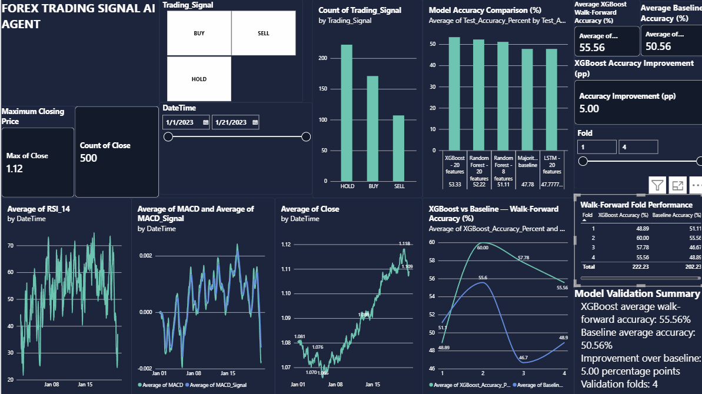

# Forex Trading Signal AI Agent


## Project Overview
This project analyses historical EUR/USD forex price data and generates BUY, SELL, and HOLD signals using technical indicators. It applies and compares machine-learning models, including Random Forest, XGBoost, and LSTM, using chronological holdout and walk-forward validation. The project also evaluates a basic trading strategy through historical backtesting and presents market trends and model performance through a Power BI dashboard and Excel report.

Model results are exploratory and do not guarantee future performance or trading profitability.

## Objectives
- Analyse historical forex price data.
- Calculate technical indicators.
- Generate trading signals.
- Evaluate strategy returns before and after assumed transaction costs.
- Prepare CSV outputs for reporting and visualisation.

## Technologies Used
- Python
- Pandas and NumPy
- Matplotlib and Seaborn
- Scikit-learn and XGBoost
- Power BI and Excel

## Technical Indicators
- Simple Moving Average (SMA)
- Exponential Moving Average (EMA)
- Relative Strength Index (RSI)
- Moving Average Convergence Divergence (MACD)
- Bollinger Bands
- Average True Range (ATR)

## Project Outputs
- `Reports/forex_technical_indicators.csv`
- `Reports/forex_trading_signals.csv`
- `Reports/forex_backtest_results.csv`

## Current Backtest Results
- Backtest periods: 499
- BUY signals: 171
- SELL signals: 106
- HOLD signals: 222
- Gross cumulative return: -0.4414%
- Net cumulative return after assumed transaction costs: -2.9471%

These are preliminary historical results based on a simplified backtest and an assumed transaction cost of one pip per active signal period. They do not represent guaranteed or live trading performance.

## Disclaimer
This project is for educational and analytical purposes only. It is not financial advice or a recommendation to trade forex.

## Machine Learning Validation
- XGBoost holdout accuracy: 53.33%
- Random Forest holdout accuracy: 52.22%
- XGBoost mean walk-forward accuracy: 55.56%
- Baseline mean walk-forward accuracy: 50.56%
- Walk-forward validation folds: 4

These results are exploratory and are based on a small historical dataset. Accuracy alone does not establish trading profitability or prove that the models will perform well on future market data.

## Reporting Deliverables
- Power BI dashboard: PowerBI/Forex_Trading_Signal_AI_Dashboard.pbix
- Excel report: Excel/Forex_Trading_Signal_AI_Report.xlsx
- Model comparison and walk-forward validation outputs: Reports/

## Reproducibility
Run the Python scripts from the project root using the project's Python virtual environment. Install the required packages before running a script. Generated reports and model outputs are stored in the Reports/ folder.

## Project Structure

```text
Forex_Trading_Signal_AI_Agent/
├── Data/          # Source forex and trading datasets
├── Excel/         # Excel analysis report
├── PowerBI/       # Power BI dashboard and data
├── Python/        # Data analysis and ML scripts
├── Reports/       # Model results and validation outputs
├── .gitignore
└── README.md
```

## Disclaimer

This project is intended for educational and analytical purposes only. Forex markets involve significant risk, and historical model accuracy or backtesting results do not guarantee future performance or profitability. This project does not provide financial advice or recommend real-money trades.


## 📊 Power BI Dashboard

The dashboard below summarizes EUR/USD price movements, trading signals, model accuracy, and walk-forward validation results.


